

# 🚀 TP12 - Software Supply Chain
### Harbor, SBOM, Cosign & SLSA

📄 **[Télécharger le rapport complet (PDF)](rapport_tp12.pdf)**

---

## 📸 Captures d'écran

Toutes les captures sont disponibles dans le dossier [`captures/`](captures/).

### 🛠️ Partie 1 : Installer Harbor

#### 1. Extraction de Harbor
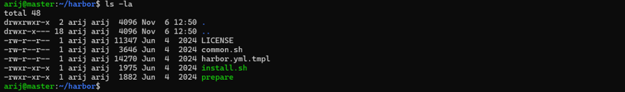

#### 2. Installation réussie
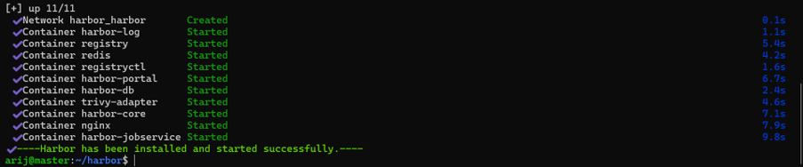

#### 3. Vérification des conteneurs
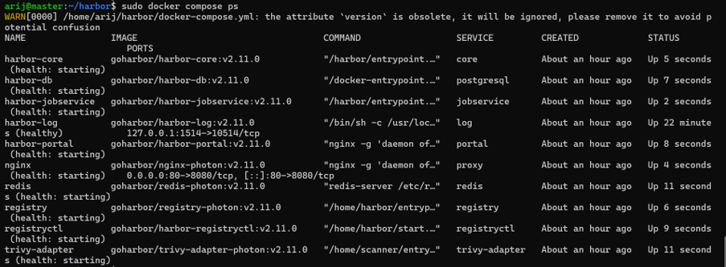

#### 4. Configuration DNS (Harbor)
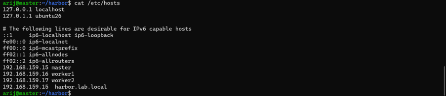

#### 5. Configuration DNS (Lab)
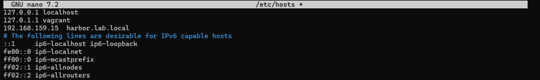

#### 6. Configuration Docker
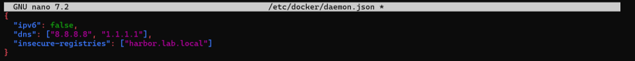

#### 7. Test de connexion (Harbor)
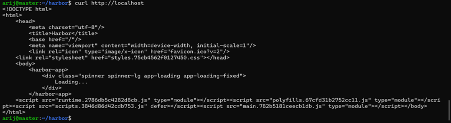

#### 8. Test de connexion (Lab)
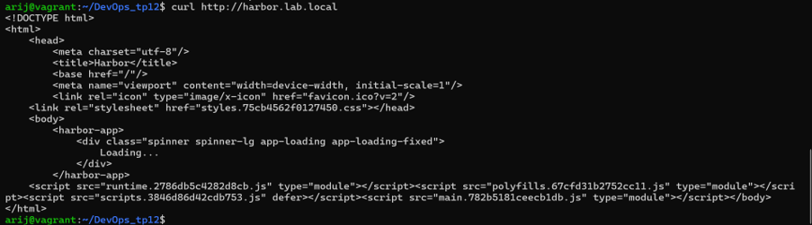

#### 9. Interface Web Harbor
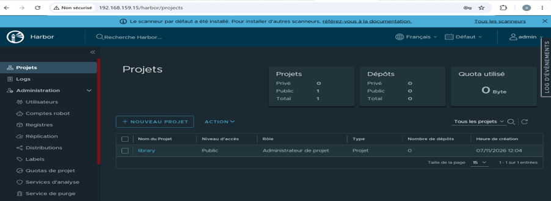

### 🛡️ Partie 2 : Projets, RBAC, scan et rétention

#### 10. Création du projet `devsecops`
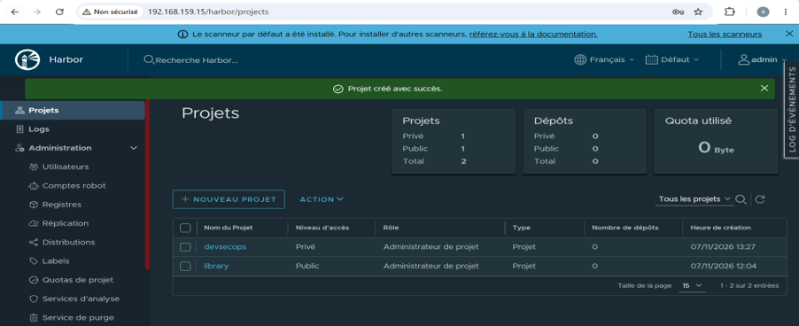

#### 11. Création des utilisateurs
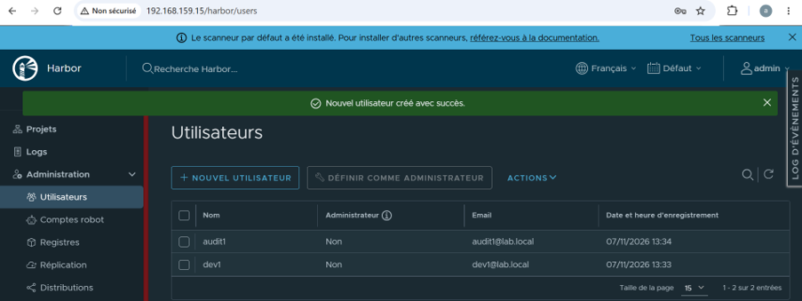

#### 12. Ajout des membres
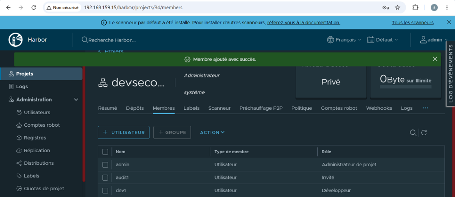

#### 13. Création du robot account
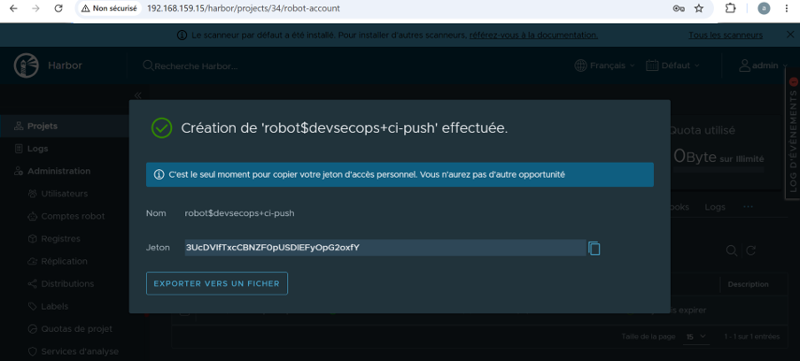

#### 14. Tag de l'image
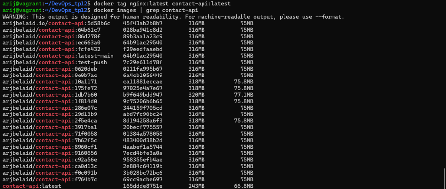

#### 15. Connexion avec le robot
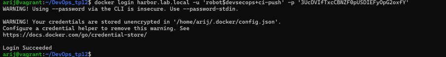

#### 16. Push de l'image
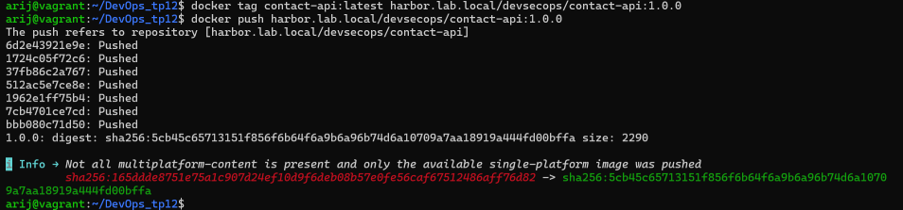

#### 17. Vérification dans Harbor
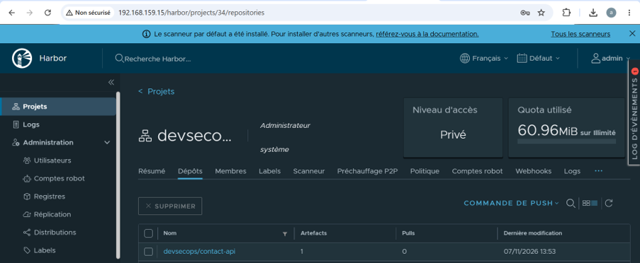

#### 18. Test RBAC (refus pour audit1)
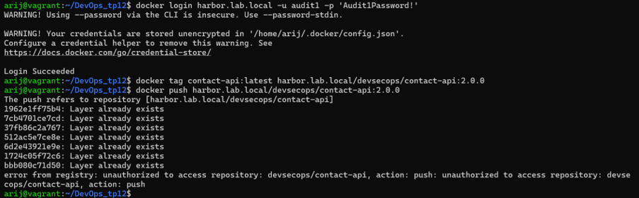

#### 19. Activation du scan Trivy
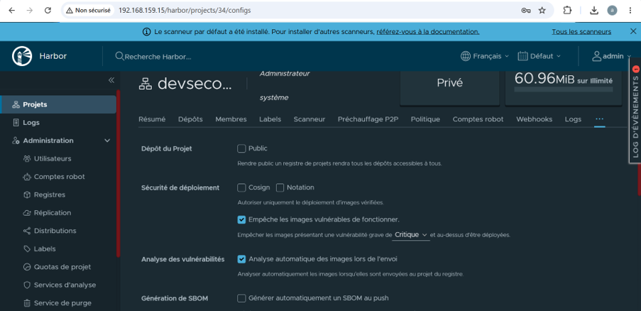

#### 20. Règle de rétention
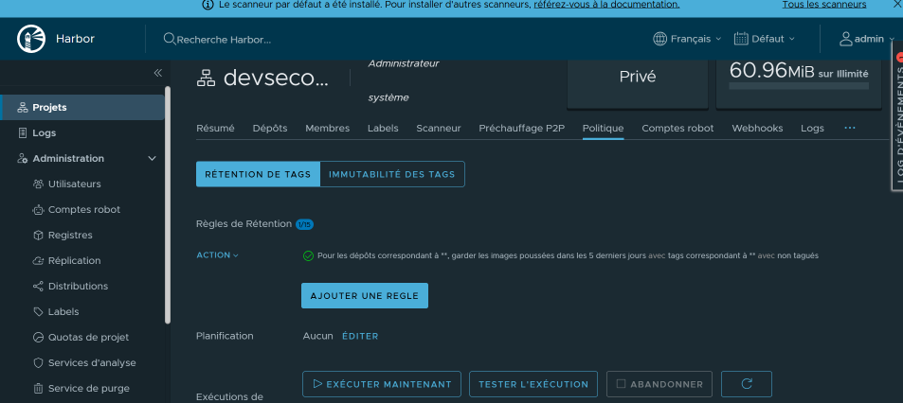

#### 21. Dry Run de la rétention
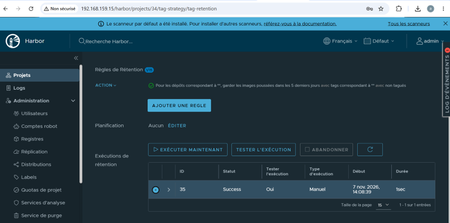

#### 22. Immutabilité des tags
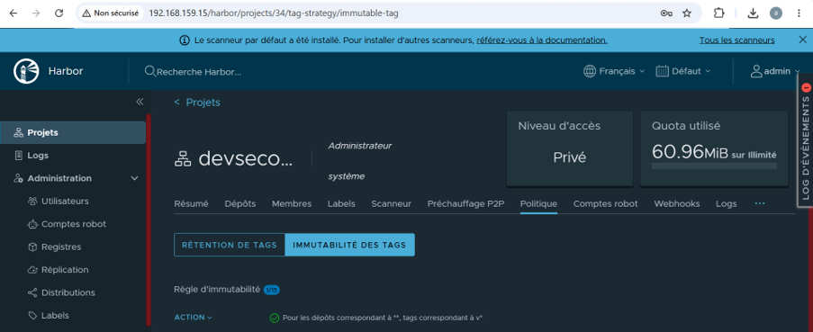

#### 23. Push d'une image vulnérable
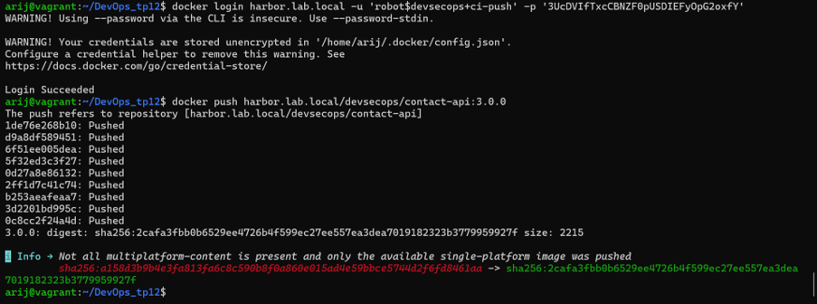

#### 24. Rapport de scan Trivy (1453 CVE)
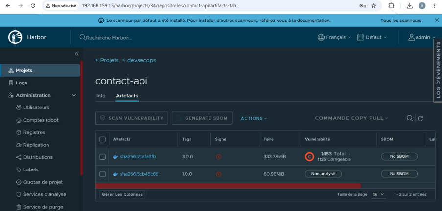

### 📦 Partie 3 : SBOM avec Syft et Grype

#### 25. Génération du SBOM
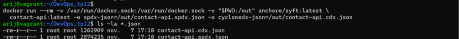

#### 26. Analyse du SBOM (154 paquets)
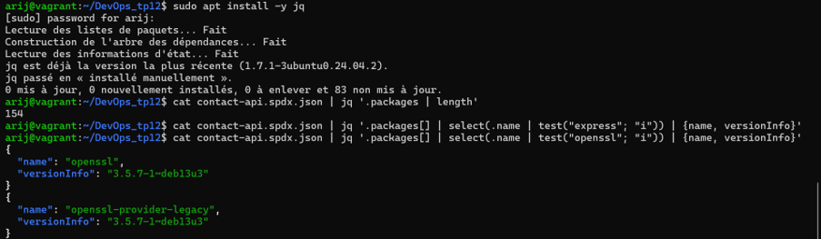

#### 27. Analyse avec Grype
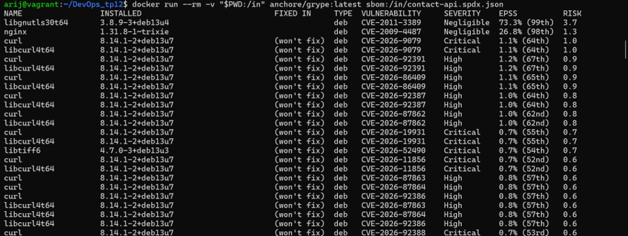

### 🔏 Partie 4 : Signer et vérifier avec Cosign

#### 28. Installation de Cosign
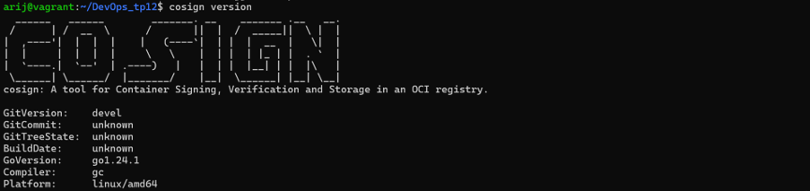

#### 29. Génération de la paire de clés
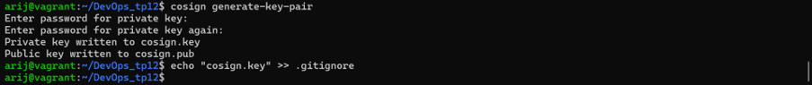

#### 30. Récupération du digest
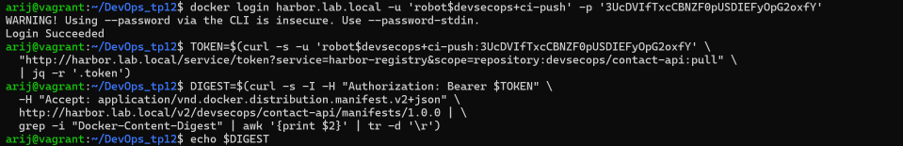

#### 31. Signature de l'image
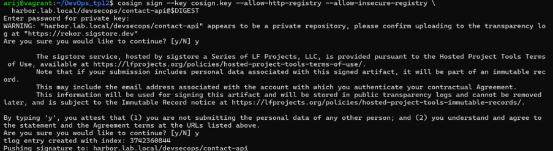

#### 32. Vérification de la signature
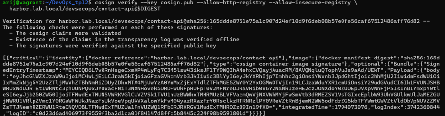

#### 33. Attestation du SBOM
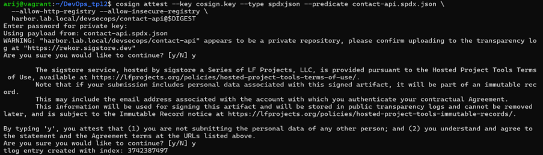

### 🔑 Partie 5 : Keyless et provenance dans GitHub Actions

#### 34. Création du tag `v1.0.0`
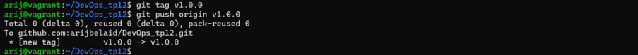

#### 35. Workflow GitHub Actions
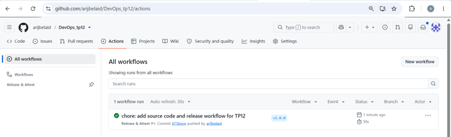

#### 36. Vérification Keyless
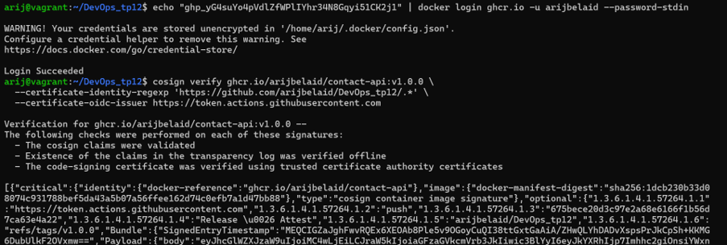

#### 37. Vérification de l'attestation
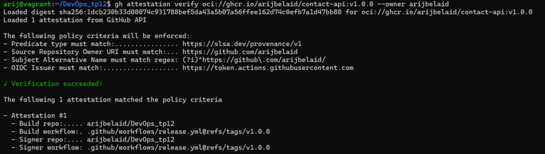

---

## 🛠️ Résumé des actions

| Étape | Outil | Action |
| :--- | :--- | :--- |
| **Registre** | Harbor | Installation, projets, RBAC, robot accounts, scan Trivy, rétention, immutabilité. |
| **SBOM** | Syft | Génération de l'inventaire (SPDX et CycloneDX). |
| **Scan SBOM** | Grype | Analyse des vulnérabilités à partir du SBOM. |
| **Signature** | Cosign | Signature de l'image avec une paire de clés. |
| **Attestation** | Cosign | Attestation du SBOM (in-toto). |
| **Keyless** | GitHub Actions | Signature OIDC sans clé privée. |
| **Provenance** | GitHub Actions | Attestation SLSA de provenance. |

---

  <b>Fait avec ❤️ par Arij Belaid</b>

